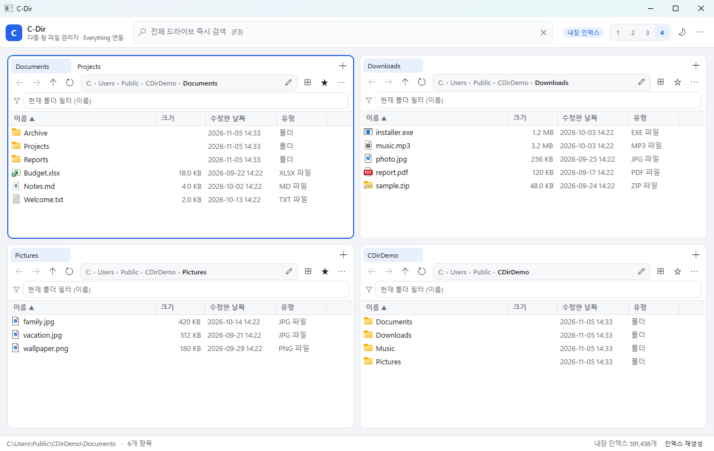

# C-Dir

**Q-Dir + Everything** 을 하나로 합친 Windows 파일 관리자입니다.

- **Q-Dir 스타일**: 1 / 2 / 3 / 4 분할 창에서 동시에 여러 폴더를 탐색, 창마다 여러 탭 지원
- **Everything 스타일**: F3 한 번으로 전체 드라이브를 즉시 검색 (Everything SDK 연동, 미설치 시 내장 인덱스로 자동 대체)
- **빠른 이동**: 클릭 가능한 경로(브레드크럼), 지연 로딩 폴더 트리, 폴더 즐겨찾기



## 주요 기능

| 영역 | 기능 |
| --- | --- |
| 분할 탐색 | 1·2·3·4 분할 (툴바 또는 `Ctrl+1`~`Ctrl+4`), 활성 창 강조 |
| 탭 | 창마다 여러 탭 (`Ctrl+T` 새 탭, `Ctrl+W` 닫기, `Ctrl+PgUp`/`Ctrl+PgDn` 전환), 탭별 경로·히스토리·선택 유지, 재실행 시 복원 |
| 탐색 | 뒤로/앞으로/위로, 경로 직접 입력, 드라이브 빠른 이동, 현재 폴더 필터 |
| 즐겨찾기 | 별(☆) 메뉴에서 현재 폴더 추가/제거, 폴더 우클릭 메뉴로 추가/제거, 별이 채워지면(★) 현재 폴더가 즐겨찾기, 메뉴에서 바로 이동·관리 |
| 경로 이동 | 주소 표시줄의 각 폴더를 클릭해 상위 폴더로 즉시 이동(브레드크럼), 트리 버튼으로 폴더 트리 표시·선택, 현재 경로 자동 동기화 |
| 검색 | 전체 드라이브 즉시 검색, 결과에서 Enter로 열기 / `Ctrl+Enter`로 폴더에서 보기, 경로 복사, 속성 |
| 파일 작업 | 복사·잘라내기·붙여넣기(Windows 탐색기와 상호 붙여넣기 지원), 드래그 앤 드롭(창 간 이동·Ctrl 복사), 이름 바꾸기, 휴지통 삭제, 새 폴더, 탐색기에서 보기, 터미널 열기, 속성 |
| 표시 | 자세히 보기, 컬럼 정렬(폴더 우선, 자연 정렬), 파일 종류별 셸 아이콘, 라이트/다크 테마 |
| 기타 | 창 크기·레이아웃·마지막 경로·탭·테마 자동 저장 |

## 실행

```powershell
# 필요: .NET 10 SDK (Windows)
dotnet run
```

또는 빌드 후 실행:

```powershell
dotnet build -c Release
.\bin\Release\net10.0-windows\C-Dir.exe
```

## Everything 연동 (선택)

C-Dir는 **Everything이 설치되어 있으면 Everything의 색인을 그대로 사용**합니다. 별도 설정은 필요 없습니다.

1. [Everything](https://www.voidtools.com/) (x64)을 설치합니다.
2. C-Dir를 실행하면 자동으로 `Everything64.dll`을 찾아 사용합니다.
   - 탐색 순서: `C-Dir.exe`가 있는 폴더 → `C:\Program Files\Everything` → `C:\Program Files (x86)\Everything` → `%LOCALAPPDATA%\Programs\Everything`
3. 툴바 오른쪽 칩이 **“Everything 연결됨”** 으로 표시되면 연동 완료입니다.
4. Everything을 나중에 설치했다면 앱 메뉴(⋯) → **Everything 다시 감지**를 누르세요.

> Everything이 없거나 실행 중이 아니면 자동으로 **내장 인덱스**로 검색합니다.

## 내장 인덱스

- 첫 실행 시 고정 드라이브 전체를 스캔해 `%LOCALAPPDATA%\CDir\fileindex.bin` 에 저장합니다.
- 스캔 중에도 부분 결과로 검색이 가능하며, 상태 표시줄에서 진행 상황을 확인하거나 **중지**할 수 있습니다.
- 이후 실행에서는 저장된 인덱스를 즉시 불러옵니다. 파일이 많이 바뀌었다면 **인덱스 재생성**을 실행하세요.
- 검색 문법(내장 인덱스):
  - 공백으로 구분한 여러 단어는 **AND** 조건 (예: `report 2024`)
  - `"정확한 구문"` 큰따옴표 지원
  - `*.pdf`, `report-?.docx` 와일드카드
  - `ext:pdf,docx` 확장자 필터

## 단축키

| 키 | 동작 |
| --- | --- |
| `F3`, `Ctrl+F` | 검색창으로 이동 |
| `Esc` | 검색 닫기 / 주소창 편집 취소 |
| `Ctrl+1`~`Ctrl+4` | 분할 수 변경 |
| `Ctrl+Tab` | 다음 창 활성화 |
| `Ctrl+T` | 현재 폴더에서 새 탭 열기 |
| `Ctrl+W` | 현재 탭 닫기 |
| `Ctrl+PgUp` / `Ctrl+PgDn` | 이전 / 다음 탭 |
| `Ctrl+L` | 주소창 편집 (경로 직접 입력) |
| `F5` | 새로 고침 |
| `Backspace` | 상위 폴더 |
| `Alt+←` / `Alt+→` | 뒤로 / 앞으로 |
| `Enter` | 열기 (폴더는 들어가기) |
| `F2` | 이름 바꾸기 |
| `Delete` | 휴지통으로 삭제 |
| `Ctrl+C` / `Ctrl+X` / `Ctrl+V` | 복사 / 잘라내기 / 붙여넣기 |
| `Ctrl+Shift+N` | 새 폴더 |
| `Ctrl+H` | 숨김 항목 표시 전환 |
| `Alt+Enter` | 속성 |

## 설정

`%LOCALAPPDATA%\CDir\settings.json`

```jsonc
{
  "PaneCount": 2,
  "PanePaths": ["C:\\Users\\me\\Documents", "C:\\Users\\me\\Downloads", "C:\\Users\\me", "C:\\"],
  "PaneTabs": [
    ["C:\\Users\\me\\Documents", "C:\\Projects"],
    ["C:\\Users\\me\\Downloads"],
    ["C:\\Users\\me"],
    ["C:\\"]
  ],
  "PaneActiveTab": [1, 0, 0, 0],   // 창별로 활성화할 탭 인덱스
  "DarkTheme": false,
  "ShowHidden": false,
  "Favorites": ["C:\\Users\\me\\Documents", "C:\\Projects"],   // 즐겨찾기 폴더
  "SearchRoots": [],        // 비어 있으면 모든 고정 드라이브
  "WindowWidth": 1300,
  "WindowHeight": 820
}
```

앱 메뉴(⋯) → **설정 폴더 열기**로 바로 열 수 있습니다.

## 프로젝트 구조

```
CDir.csproj
App.xaml(.cs)              앱 시작, 테마, Everything DLL 탐색
MainWindow.xaml(.cs)       툴바·분할 레이아웃·검색 결과 패널·전역 단축키
Controls/FilePane.xaml(.cs)  한 개의 탐색 창 (탭, 탐색, 브레드크럼, 폴더 트리, 정렬, 파일 작업)
ViewModels/                FilePaneViewModel, PaneHostViewModel(탭 호스트), SearchViewModel
Models/                    FileItem, AppSettings
Services/
  NativeFileIndex.cs       내장 인덱스 (스캔·저장·부분 검색)
  EverythingSearch.cs      Everything SDK P/Invoke 래퍼
  SearchService.cs         Everything → 내장 인덱스 폴백
  ShellOps.cs              셸 복사/이동/삭제/속성/터미널
  ShellIcons.cs            확장자별 셸 아이콘 캐시
  SettingsStore.cs         설정/캐시 경로
  FavoritesStore.cs        창 전체가 공유하는 폴더 즐겨찾기
  ThemeManager.cs          라이트·다크 팔레트 및 타이틀바
  FileClipboard.cs         내부/시스템 클립보드
Themes/Base.xaml           색상 토큰과 컨트롤 스타일
Dialogs/InputDialog.xaml   이름 입력 대화상자
```

## 제한 사항

- 내장 인덱스는 전체 재스캔 방식입니다 (USN 저널 증분 갱신은 미지원). 필요할 때 **인덱스 재생성**을 사용하세요.
- 심볼릭 링크·정션(`ReparsePoint`)과 접근 불가 폴더는 인덱싱에서 제외됩니다.
- 네트워크 드라이브는 기본 인덱싱 대상이 아닙니다.
- Windows 10/11 x64 전용입니다 (WPF + `Everything64.dll`).
